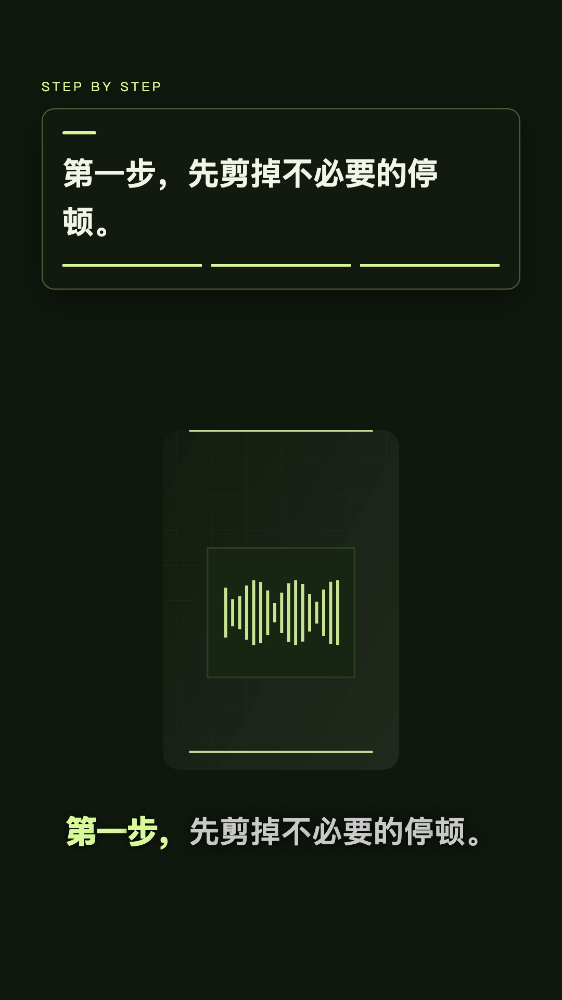

# Saymivo · 本地口播视频工作台

把口播整理成可以继续编辑的视频：**中文字幕、术语校对、停顿裁剪、重点文字、讲义与录屏编排、MP4 导出**。

[English](README.en.md) · [图形演示与复现](docs/demo.md) · [开发与架构](docs/architecture.md) · [贡献指南](CONTRIBUTING.md) · [路线图](docs/roadmap.md)

适合希望在自己电脑上处理中文口播、并愿意逐段校对的创作者和开发者。基于 [AutoBroll](https://github.com/andriidrok1/autobroll) 扩展，React / TypeScript / Remotion 驱动。当前为早期本地工具，验证平台为 Apple Silicon macOS。

## 看看实际画面



此图由项目视频组件渲染，使用内置无真人图形素材、预设文字，无声音。它展示字幕与动效排版，**不代表自动识别准确率或陌生口播的自动剪辑质量**。[查看演示、生成素材与工程](docs/demo.md)。

## 为什么试用

- **本地优先**：faster-whisper 识别，基本字幕与术语流程无需 API 密钥；原片和工程保存在本机。
- **字幕可以核对**：个人术语词库、纠错对照、字幕时间调整；保留源时间与剪辑映射。
- **内容分层编辑**：重点字、讲义、独立录屏、聚光与行内高亮、人物圆窗、分镜与关键帧。
- **从自动到手工**：可直接剪辑，也可先审阅分镜，再替换素材和修改局部；保存工程后继续编辑。
- **预览与导出**：Remotion 预览、横竖屏布局、后台进度、取消重试和 1080p MP4 导出。

## 几分钟启动界面（macOS）

需要 **Node.js 22+、npm、Python 3.10–3.12（建议 3.12）、zsh、FFmpeg / ffprobe**。首次依赖与模型下载可能较久，不承诺几分钟完成识别或导出。Windows / Linux 尚未完成安装验证。

```sh
git clone https://github.com/Olandooooes/saymivo.git
cd saymivo
# 如已安装 Homebrew，且尚无 ffmpeg / ffprobe：
brew install ffmpeg
npm run setup
npm start
```

打开 <http://127.0.0.1:5188/>，保持终端运行。以后也可双击 `启动 Saymivo.command`。安装脚本创建 `.venv`、安装 Python 依赖与本地 FFmpeg，并在缺少时创建 `.env`；ffprobe 仍需系统安装。

先不下载语音模型：在首页选择**演示**入口，使用无真人、无声音的内置图形工程体验编辑和预览。开发者仅检查界面也可运行 `npm ci && npm start`；图形素材生成需要 Python 依赖。[详细演示步骤](docs/demo.md)。

### 处理自己的口播

1. 选择模板、画幅与字幕校对方式，导入 MP4 / MOV / WebM；默认开始一键流程。
2. 首次识别默认下载多语言 `small` 模型；可用 `AUTOBROLL_MODEL` 指向本地 faster-whisper / CTranslate2 模型目录。
3. 预览并核对人名、数字、术语和剪口；必要时逐段改字幕、分镜、人物构图与配套素材。
4. 保存工程，下载 MP4。刷新页面可继续查看当前任务。

[配置示例](.env.example) · [依赖、模型和故障排查](docs/setup.md)

## 数据与服务

原片、字幕、工程、导出在 `public/`；任务在 `.auto-jobs/`，个人词库在 `.proofread.json`，历史校对及媒体库也在本地隐藏文件中。它们被 Git 忽略；忽略规则不是访问控制。服务只应在可信本机使用，不要把端口暴露公网。

默认使用本地识别与术语规则。**选择 Gemini 校对会发送字幕文字和术语信息**；可选 AI 编排或画面分析还可能发送选定文本或画面。Pexels 搜索需要网络和密钥。启用前请查看 `.env.example` 和具体功能配置。依赖、模型下载及首次浏览器下载也需要网络。

## 当前限制

- 自动字幕、摘要、切点与布局都可能出错，需要人工审阅；没有跨素材成功率或“95%还原度”证明。
- 默认人物布局不是自动人脸跟踪；讲义/录屏需提供对应素材，专业配图不会凭空生成。
- 字幕内部词时间可能是估计；整句校时不代表逐词声学验证。
- 不是独立桌面安装包，也不是公网多用户服务；不同背景、走动和长片稳定性仍需更多验证。
- 前端构建和单元测试不等于完整语音/渲染端到端验证。

## 参与开发

```sh
npm ci
npm run check
```

包含 TypeScript 检查、Node 单元测试和 Vite 构建。无需真实视频或 API 密钥。[架构与数据格式](docs/architecture.md)、[贡献指南](CONTRIBUTING.md)、[路线图](docs/roadmap.md) 提供入口。欢迎可复现的字幕问题、合成示例、平台安装反馈和小范围修复。

## 来源与许可

源码适用 [MIT](LICENSE)，保留 AutoBroll 原版权声明；来源快照见 [UPSTREAM.json](UPSTREAM.json)，上游说明见 [README.upstream.md](README.upstream.md)。产品名称统一为 **Saymivo**；`koubo-studio` 是旧本地目录/内部兼容标识，`AUTOBROLL_*` 保留配置兼容。

字体及第三方代码、模型、素材和服务有各自条款，见 [第三方声明](THIRD_PARTY_NOTICES.md)。Remotion 的使用条件应按你的场景单独核对；仓库 MIT 不覆盖外部依赖的一切用途。
