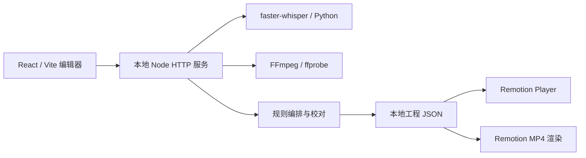

# 开发与架构

| 目录 | 责任 |
|---|---|
| `editor/` | 启动页、时间线、素材、分镜、字幕/视觉编辑工具及 Zustand 状态 |
| `server/` | 本地 HTTP API、后台任务、自动编排、素材与校对记录 |
| `scripts/` | 识别、源音频时间基准、停顿分析、渲染及工具 |
| `src/` | Remotion 组件、字幕/场景模型、时间映射与布局规则 |
| `mcp/` | 可选 MCP 工具入口；用 `npm run mcp` 启动 |
| `tests/` | 不依赖私人素材的单元测试及合成夹具 |
| `public/` | 运行时素材、字幕、工程和导出；仅字体和空目录占位提交 |

## 工程数据

一个工程主要包含 `clips`、`captions`、`presentation`、`brolls` 和 `music`。`clips` 用 `src` 引用 public 相对路径，`inSec/outSec` 为源视频秒数；字幕通过 `clipId` 绑定源视频毫秒数，再投影到剪辑时间线。剪切、重排与变速不能把源时间误当输出时间。校对历史绑定素材身份及音频时钟。

可编辑场景与字幕分开：字幕表达原话，场景控制讲义、重点字、屏幕媒体、高亮与人物布局。具体字段以 `src/timeline.ts`、`src/captions.ts`、`src/presentation.d.mts` 为准。[图形示例](demo.md) 可生成真实可加载工程。

## 本地检查

`npm run check` 执行类型检查、Node 测试和前端构建。CI 在 Linux 上检查这三个层面；这不代表 Linux 完整安装受支持。涉及 Python 音频处理时可额外运行 `.venv/bin/python tests/source_audio_regression.py`；涉及打包时运行 `.venv/bin/python tests/package-auto-review.test.py`。这些工具测试使用临时合成文件，不要求私人录音。

涉及视频组件时，优先用合成工程查看局部帧；仅在有理由时做完整渲染。端到端模型识别与人工听审需要另外记录。
