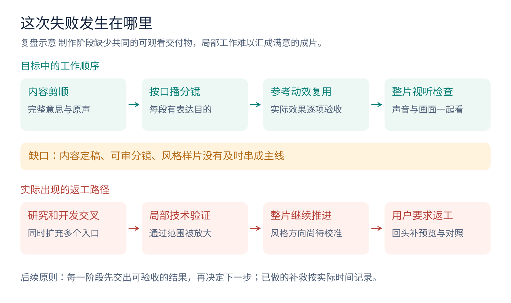
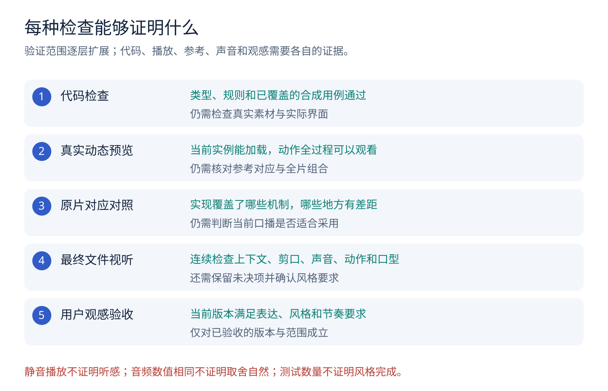
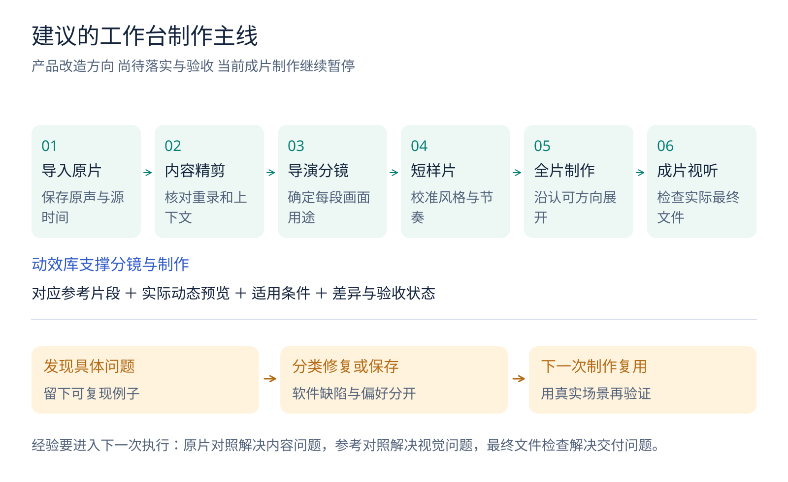

# 口播工作台夜间返工失败复盘

复盘范围：2026年10月22日晚至23日早，时间均按北京时间。为说明返工起因，另列此前几版的相关问题；23日早上开始补做的工作单独标注。

这次任务希望把近期参考视频中的动态表达研究清楚，整理成可复用的动效库，接入口播工作台，再根据当前口播内容安排画面。实际推进中，参考研究、组件开发、界面验收和成片剪辑交叉进行，缺少明确的阶段交付。结果是技术工作持续增加，用户却很难看到每一种动效究竟做成了什么，成片的变化也没有达到预期。

**这次最主要的失败，是用局部实现与技术检查，过早判断整体交付的完成度。** 后续需要把内容连贯、动态效果、参考对应、整片节奏和真实视听分别验收，再决定能否进入下一阶段。

本文配图均为原创说明图，流程中的建议尚待落实；图形中的人物和界面是合成示意。公开版本不包含私人原片、原话、聊天截图、账号凭据或第三方视频文件。本次上传仅发布复盘文档与配图，不表示本机所有代码修改已经发布到仓库主分支。

## 一 目标和实际推进之间的差距

图1：目标要求每一阶段交出可观看的结果。实际推进把多个阶段并在一起，缺少分镜方案和短样片的及时校准。

| 方面 | 需要达到的结果 | 已暴露的问题 | 带来的影响 |
|---|---|---|---|
| 口播内容 | 删除口误、长停顿和失败重录，保留完整意思与原声 | 前序版本既有重录处理不足，也有后续删减过多、衔接不顺 | 画面再丰富，也无法弥补表达断裂 |
| 参考研究 | 看清动作发生的全过程，记录人物、资料、文字怎样配合 | 已有有序采样与慢放记录，但不足以证明逐原始帧分析；研究与实现的对应关系不够直观 | 难以判断究竟学到了哪些机制、实现了多少 |
| 动效库 | 每个效果都能实际播放，并和参考片段对照 | 文字说明、预设和参数入口先变多，统一的逐项动态验收展示没有同步完成 | 用户看到的是目录，无法直接验收效果 |
| 画面设计 | 围绕每段口播选择合适表达，形成全片节奏 | 文字显隐、资料板和相似版式占比过高；背景与组合方式变化不足 | 虽有动画，整体仍显单一 |
| 文字布局 | 完整、清楚、留有阅读时间 | 旧逻辑存在标题截短、固定列宽及高度不足导致的裁切 | 关键信息没有完整传达 |
| 成片检查 | 连续检查声音、上下文、动作、人物和最终文件 | 做过技术检查、画面采样和静音播放，但听感与口型检查仍有缺口 | 完成了部分验证，却不能宣布成片合格 |
| 无人值守 | 沿用已授权通道，遇阻能收敛，醒来可看到明确成果 | 用户反馈出现权限等待；部分调用缺少足以确定原因的原始记录 | 时间成本增加，交付状态不透明 |

## 二 这次返工是怎样扩大起来的

以下按阶段描述，不给无法核准的操作补写精确时刻。

| 阶段 | 发生了什么 | 当时应该交出的结果 |
|---|---|---|
| 前序初剪 | 输出能播放，但重录、停顿和视觉安排没有充分满足要求 | 先交出内容完整、可对照原片的纯口播精剪 |
| 前序再次返工 | 用户指出有些字句删除过多，版式重复、文字被截断 | 明确内容取舍，恢复完整意群；用短段验证布局与动态方向 |
| 22日晚参考研究与开发 | 保存五条参考的有序样本和重点慢放记录，同时继续增加动态组件及编辑入口 | 研究清单、对应原片片段、动作规格和实际样例应逐项对应 |
| 夜间成片与技术修复 | 对工程和导出做了多轮修复、画面核验；同时仍有未完成的组件验收 | 稳定的样片方向、清晰的全库验收缺口，以及当前成片的视听结论 |
| 23日早用户复查 | 用户仍不满意动效多样性，要求暂停，并先看真正动起来的库 | 停止成片推进，提供逐项播放、原片对照和完成状态 |
| 23日早后续补做 | 开始准备独立预览样例、播放器和真实参考片段 | 这些属于补救工作，不能回填成昨晚已经交付的成果 |

**返工扩大的关键节点，是在画面方向尚未得到实际样片校准时，继续扩充组件并推进全片。** 每新增一项局部能力，都会带来配置、界面、素材、预览和导出的验证工作；这些工作如果没有服务于同一个阶段交付，就会挤占内容检查和实际观看的时间。

## 三 逐项失败与原因

### 1 内容取舍缺少独立验收

前序版本出现过两类问题：需要删除的失败重录仍被保留；后来又有部分字句删得过多，导致上下文不连贯。这说明“识别重复”和“判断哪一遍表达更好”不能混为一件事。

过度删减中包含把“删除失败重录”和“压缩讲解内容”混在一起的编辑取舍，不能全部归咎于某个一键AI功能。回问、对比、举例和能力限定需要作为完整语义链保留；对齐文字或与保留稿逐字相等，也不能独立证明原声就说了这些字。

现有本地精剪已经能利用词级识别、前后版本对齐、独立窄窗识别和声学切缝生成候选，并支持可撤销应用。但它仍会漏掉近义改说、被识别合并的重录，也不能普遍判断表达质量。完整重复还可能是有意强调。

另一个已经复现的代码问题，是旧分割逻辑主要按字幕开始时间改绑片段。跨剪口的句子可能留在前半，后半虽然有声音，却没有对应字幕。这属于确定的字幕绑定缺陷，不能用来解释每一处历史空窗。

**改进要求：** 先交出可以连续听的纯口播精剪。每个删除决定保留原片时间、保留版本和理由；剪口需核对前后的完整意群。否定、数字、专名与能力限定不能因为句子变短就丢掉。证据不足的候选保留待核，不能把“一键识别”宣传成“一键全清”。

### 2 参考研究没有及时变成可核验的动作规格

本地研究记录覆盖五条参考，总时长约29分33秒，保存了有顺序的全段采样、重点慢放及修正记录。这些记录可以支持对可见阶段的归纳，但截图采样率低于原视频帧率，不能证明逐原始帧分析，也没有测出原工程的全部缓动曲线。

静音观察可以借助可见字幕理解部分表达关系，却不能代替参考原声的听审。由截图串成的回放也只能称为采样回放，不能标成原视频片段。

真正可复用的规格，应把同一种表达拆成完整过程：什么触发动作，谁先动，人物和资料怎样换位，旧对象是否保留，观众何时读清文字，最后怎样交给下一画面。相同机制的不同颜色、不同文本，不应重复计作新的成熟动效。

图2：这是解释动作规格的合成示意，不是博主原片或工作台截图。验收应观看完整动作及前后衔接，单张截图只能说明一个时刻的构图。

**改进要求：** 每项记录都连接到可播放的对应原片范围、实际实现预览和差异说明。没有看清的阶段明确标为未知；只能覆盖相关基础表达的实现，按部分完成管理。

### 3 动效入口数量替代了实际完成度

工作台逐渐增加了参考分类、基础预设、高级参数和推荐入口，但不同入口处于不同成熟阶段。有些只有配置和静态合同检查，有些做过真实预览，有些完成应用或导出，还有些实际播放仍失败。

同一条成片里多次使用一种文字机制，不能证明多种独立动效都已验收。研究条数、注册入口数、测试数量、应用场次数，也不能互相换算。

**改进要求：** 每项分别记录四类状态：研究是否清楚、实现是否存在、实际制作是否验证、视觉效果是否认可。预览页需要展示真实运动和失败原因。相似组件的通过结果不能自动继承给另一项，也不能替用户勾选满意。

### 4 局部推荐能力被期待承担整片导演工作

现有动态推荐主要从保留字幕、场景文字、节点、资料和关键词中生成候选，属于本地规则建议。它能提供部分理由，也保留了前置数据和安全检查，但还没有形成对整段叙事、情绪重点和全片节奏的完整设计。

当一个局部规则反复命中相近机制时，结果就容易变成相似资料板、相似文字和相似背景。随机换一个动画同样无法保证适合当前内容。

**改进要求：** 在选择组件前增加可审阅的画面方案。每段先写清表达目的、需要的证据、人物位置、画面内容、动作时点和衔接方式，再从已验证的库中调用。真人持续讲解也可以是合理选择，但需要符合这段内容和整片节奏。

### 5 文字和版式没有充分适应真实内容

已经复现的旧逻辑包含两类问题：部分标题由关键词或固定前几个字派生，完整意思因此被截短；部分布局主要按字符数估算宽度，缺少实际高度约束，外层隐藏溢出后造成裁切。固定多列也使不同长度、不同关系的内容被套进相似结构。

本地已经加入真实字体测量、宽高约束和完整分页等修复。这些修复仍需在当前字体、画幅、人物位置和最终导出中检查，不能据此宣称所有版式问题消失。

**改进要求：** 布局先保证全文、阅读时间和避脸区域。文字超出容量时，优先分步展示、分页或改变构图。内容关系决定分组方式；长短不一的内容需要不同空间，不能默认等宽三列。任何摘要改写都需另行核对语义。

### 6 技术证据与视听结论混用

本次确实发现并修复了一些技术问题，包括跨剪口字幕、同源分镜投影、字幕导入舍入、保存正文的UTF-8分块解码、人物圆窗短暂缺失和特定本机编码链的音频收尾问题。它们有相应复现或验证价值。

但不同证据回答的问题不同。测试通过不说明成片好看；采样画面清楚不说明整段动作自然；静音播放不说明剪口听感正确；音频包或解码采样一致，也不说明口误取舍和口型正确。

图3：每一层都有独立作用。前一层通过，可以进入下一层检查，不能直接继承下一层结论。

今早的实际导出复查先发现字幕压到下脸，随后又发现两处单帧人物圆窗缺失。曾把部分人物缺失解释为入场留白，后来依据相邻帧和顺序解码纠正；旧候选因此被拒绝。新文件的复查不能倒过来证明旧候选没有问题。

后续正式文件做过全流解码、联系图审阅、连续原速静音播放和音频数值核验。23日07时29分的状态记录仍明确保留未听审、未最终认可的边界：未发现新的确认画面阻断，听审、含混语句和口型仍有未核项，用户对动效多样性的要求也没有通过验收。公开经验文档还出现过开头摘要未跟随后文更新的情况，容易让完成状态进一步混乱。

**改进要求：** 交付状态统一来自当前版本，并分别说明内容、画面、声音和用户观感。修改产生新版本后，旧文件的验证只能按适用范围继承。最终检查应面对真正要交付的MP4，包含连续视听及重点剪口复核。

### 7 无人值守任务缺少及时收敛与可信交接

用户已经授权必要操作，并明确希望减少夜间确认等待。已有可用的控制、截图和浏览器通道应持续沿用；交接给子任务不能成为重新询问相同授权的理由。

用户反馈发生过权限弹窗和长时间等待。不过，现有记录不足以确定每次弹窗的实际内容、触发工具和原因。历史审计中的长耗时调用还涉及不同日期，不能全部算成本晚的权限阻断，更不能直接归因于操作系统截图权限。

**改进要求：** 启动前验证已授权通道；每次异常记录工具、动作、时间和原始返回。通道失效后停止盲目重试，转向已授权的替代路径或可独立完成的工作，并保留可交接成果。宽泛的用户授权不能取消系统或平台实际存在的边界，也不应通过关闭安全保护解决普通截图问题。

### 8 工程偏好与制作流程没有完整衔接

此前手动新工程的回调没有完整传递首页选择，字体、配色和节奏等设置可能落回默认值；首次未保存生成方式时，还会直接走向完整导出。制作说明也曾进入视频画面。这些都是可以具体修复的流程问题，不能只记成下次操作时注意。

本地已补充偏好传递和默认先看分镜的行为。已有工程和显式选择需要保留，说明文字留在核对文档中。后续检查应覆盖“新工程默认继承”和“用户主动改选”两条路径，并在实际视频中确认当前设置确实生效。

## 四 根因归纳与责任

可以确认的核心原因有五项。

1. **阶段交付不清。** 研究、开发、制作并行，却没有共同指向一个可观看、可验收的结果。
2. **完成标准过早。** 局部可运行、参数可填写或测试通过，曾被过度用于解释总体完成度。
3. **全片编排能力不足。** 局部规则能提候选，仍缺少稳定的内容理解与视觉节奏方案。
4. **反馈没有充分进入执行流程。** 已有文字经验，但尚未全部落实为默认行为、真实案例检查和逐项验收。
5. **状态维护不一致。** 历史测试数、旧摘要和新文件结果混在一起，增加了复核成本。

本次执行在任务组织、阶段汇报和验收判断上承担直接责任。已经完成的技术修复应保留，未完成的内容与观感要求也必须如实保留。工具限制、权限等待或投入时长，均不足以证明任务达到交付要求。

## 五 截至复盘时的真实状态

本表描述本地状态，不能据此推断GitHub主分支已经包含全部实现。

| 项目 | 已有结果 | 仍缺什么 |
|---|---|---|
| 五条参考研究 | 有序采样、重点慢放、机制分类与未知记录 | 每项对应的完整原片动态对照；逐源帧与精确曲线没有完成证明 |
| 动效实现 | 存在多类实际组件和编辑入口；部分做过真实应用及导出 | 全库逐项动态验收，以及用户对实际效果的认可 |
| 口播精剪 | 有本地候选生成、保守自动删除与可撤销应用 | 普遍识别近义重录、判断表达质量和当前成片的连续听审 |
| 当前成片 | 已产生后续正式文件，并完成部分技术和画面检查 | 原声听审、未决语句、口型，以及动效风格验收 |
| 独立动效验收页 | 23日早开始准备样例和真实组件播放器 | 页面整合、逐项实际播放、原片对应展示；尚未交付完成 |
| 原片参考片段 | 23日早补做了一条真实短片段的本地准备 | 其余对应片段及实际并排验收；不计为昨晚已完成 |
| 原成片目标 | 已按用户要求暂停 | 未经后续验收，不继续扩大成片返工 |

## 六 工作台应该怎样改

图4：建议将制作过程收敛为一条主线。这里描述产品改造方向，不表示这些阶段已全部实现。

| 阶段 | 必须产出的结果 | 进入下一阶段的依据 |
|---|---|---|
| 内容精剪 | 纯真人原声版本、删除清单、前后原片对照 | 意思完整，重录取舍有依据，剪口听感自然 |
| 导演分镜 | 每段原文、表达目的、画面依据、所选机制、动作与衔接时点 | 画面与内容对应，素材可用，文字可读，整片节奏有安排 |
| 动效调用 | 已验证组件与当前内容、素材和画幅的实际组合 | 当前实例可播放，差距可见，未完成能力不会被默默替换 |
| 短样片 | 有代表性的约45至60秒实际视频 | 字体、人物、背景、信息密度和动作方向符合预期 |
| 全片制作 | 沿已认可方向完成全片，局部可修改 | 改动范围清楚，原声与源时间保持正确，局部修改不无谓重做全部 |
| 成片验收 | 实际最终文件、连续视听结论和未决项 | 内容、声音、画面分别检查；不以技术通过代替观感认可 |

现有识别、源时间映射、时间线、撤销、预览和导出能力继续复用。优先补齐主流程和阶段交付，再扩展动效种类。严格的媒体和数据检查应保留，同时需要改进依赖范围，减少局部修改导致的大量无关重审。

当前收口顺序仍按用户要求执行：先完成逐项动效预览与原片对照；据实际验收补齐差距；之后才进入风格样片和整片制作。

## 七 怎样把这次反馈变成下次的经验

已有经验目录继续使用，每个案例保留一条从问题到复查的链路：

**用户可见失败 → 可复现例子 → 已确认原因或待查原因 → 具体修复 → 回归检查 → 实际视频验证 → 剩余问题。**

| 反馈类型 | 应沉淀到哪里 | 下次如何生效 |
|---|---|---|
| 否定、举例或前提被删掉 | 精剪取舍规则、合成复现、剪口试听范围 | 分析时保护完整意群，应用前能对照原声，应用后连续听审 |
| 标题不完整、长文字裁切 | 布局代码、字体测量和长文字用例 | 当前字体和画幅检查宽高、分页及阅读时间，再看实际导出 |
| 版式和动态重复 | 分镜方案、整片编排规则和样片记录 | 在全片尺度检查用途与重复，按内容关系选择表达 |
| 动效达不到参考 | 对应原片、动作规格、实际动态样例和差异表 | 标明部分完成，补齐动作全过程后再验收 |
| 字体、配色、节奏偏好 | 独立个人偏好 | 新工程默认继承明确选择，当前任务的显式要求优先 |
| 夜间等待或通道异常 | 操作记录和通道恢复规则 | 沿用已授权路径，出现异常及时收敛并交接，不重复盲等 |

软件缺陷、内容取舍和个人审美需要分别记录。一次个案的配色或某个动画不能自动变成所有视频的默认风格；一条用户反馈也不能未经复现就被宣布已经找到技术根因。

## 八 后续任务的执行检查

开始时确认当前要求、参考范围、可用素材、已授权通道和暂停状态。把阶段成果写清楚，区分研究、代码、实际预览、导出和用户验收。

制作时先稳定内容，再安排画面。任何动效都要有表达目的、可用素材、全文展示和阅读时间；人物遮挡、数字变化、波形、真实操作和业务结果只能使用有依据的数据或素材。

交付前检查当前保存工程与实际最终文件。代码检查、局部预览、画面采样和连续视听各自保留结论；没有做的听审或没有通过的效果直接标明。暂停的目标保持暂停，补救工作不计作原阶段已经完成。

## 九 复核依据与公开边界

本次复盘依据当前本地代码、经验案例、实际UI操作清单、导出检查记录和用户反馈归纳。以下为本机复核入口，仅列仓库相对路径，不随本文上传私人记录：

- 内容与返工机制：`docs/experience/2026-10-22-rea-rework.md`、`docs/retake-analysis.md`。
- 动效与布局：`docs/experience/2026-10-22-motion-library.md`、`src/text-fit.mjs`、`src/dynamic-motion-planner.mjs`、`src/motion-reference-catalog.mjs`。
- 参考观察范围：`docs/motion-reference-research.md`；采样结论保留其帧率、静音和未知阶段限制。
- 私人验证索引：`inspection/rea-rework/evidence.md`、`inspection/evidence/motion-ui-acceptance-current.json`、`inspection/evidence/rea-v3-final-qa/`、`inspection/agent-reference/unattended-permission-audit.json`。

这些路径用于本机追溯，其中部分本地文档和代码尚未发布。私人证据未包含在此次提交中；公开读者可以阅读本文的机制与改进方案，不能据此独立复核私人视频的全部逐帧、听感和审美结论。
